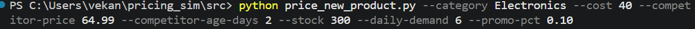
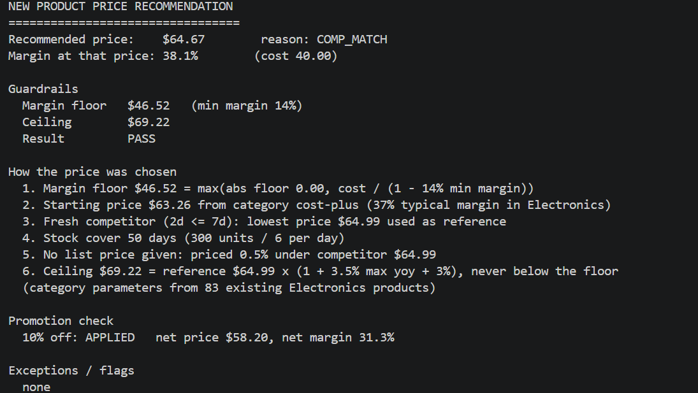
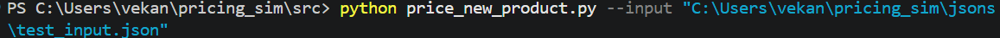
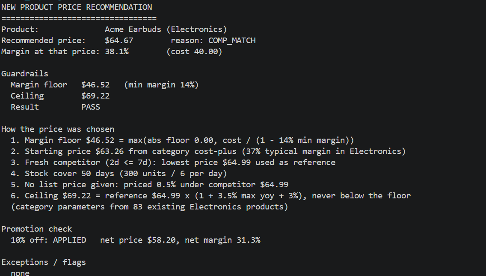
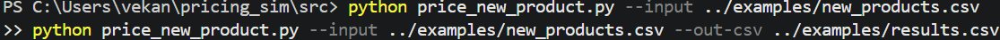
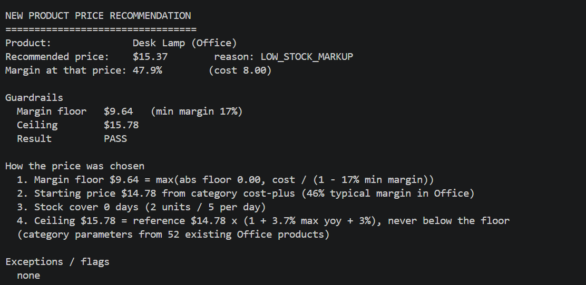

# Pricing & Promotion Simulation – Synthetic Dataset

Fully synthetic, deterministic dataset for simulating price decisions using demand, stock, competitor observations, promotion
rules and margin constraints. No external data, no personal data.

## Layout

| Path | Content |
|---|---|
| `src/generate.py` | Generator (same code for starter and full scale) |
| `src/schema.py` | Data dictionary, enums, keys, DDL (single source of truth) |
| `src/bundles.py` | Inventory-age (FIFO) and bundle business rules as pure functions (used by generator, validator, tests) |
| `src/validate.py` | Validation (190 checks), rule-based anomaly detectors, business metrics |
| `src/reproduce.py` | Regenerates twice and compares row counts + SHA-256 |
| `tests/test_bundles.py` | 19 unit + data tests for the bundling feature (`python -m unittest discover -s tests -v`) |
| `data_full/` | 5,000 SKUs, 180 days, 2,000 promotions (CSV, ~350 MB) |
| `data_starter/` | 500 SKUs, 60 days, 150 promotions (CSV + `seed.sql`, ~30 MB) |
| `<data>/ground_truth/` | `ground_truth_anomalies.csv/.json`, `ground_truth_decisions.csv` – **never join into input features** |
| `<data>/` docs | `data_dictionary.md/.json`, `schema.sql`, `rules_config.json`, `source_manifest.json`, `generator_command.txt`, `validation_summary.md/.json`, `metrics.json`, `reproducibility_report.json` |

## Generator command (fixed seed 20261022)

```
cd src
python generate.py --skus 5000 --days 180 --promos 2000 --seed 20261022 --out ../data_full
python generate.py --skus 500  --days 60  --promos 150  --seed 20261022 --out ../data_starter --sql   # --sql also emits seed.sql
python validate.py ../data_full
python reproduce.py ../data_full/reproducibility_report.json --skus 5000 --days 180 --promos 2000 --seed 20261022
cd .. && python -m unittest discover -s tests -v      # bundling tests (generate a small dataset in a temp dir)
```
Window: 2026-04-26 … (+days−1). Requires Python 3.10+, numpy, pandas. `seed.sql` is emitted for the starter set; add `--sql` for full
(≈1M-row INSERT file) or load the CSVs against `schema.sql`.

## Entities & relationships

```
Product 1─N AnnualPriceHistory (5 rows)   Product 1─1 PriceGradient (derived)
Product 1─N CostRecord            Product 1─N PriceHistory      PriceDecision 1─N PriceHistory (governing decision)
Product 1─N InventorySnapshot     Product 1─N CompetitorObservation
Product 1─N PriceDecision         PriceDecision N─M Promotion via DecisionPromotion (APPLIED / REJECTED + reason)
Promotion N─M Product via PromotionProduct          Promotion N─M Promotion via PromotionExclusion (conflicting coupons)
Promotion 1─N PromotionRule (>=1)                   Promotion 1─N PromotionEvent (append-only lifecycle)
Product 1─N Orders ; PriceHistory 1─N Orders ; PriceDecision 1─N Orders
Product 1─N InventoryLot (FIFO receipt lots)          Product 1─N ProductBundle (as primary AND as secondary SKU)
ProductBundle 1─N BundleOrder ; BundleOrder 1─2 Orders (one line per component SKU, Orders.bundle_order_id)
```
Optional relationships: `PriceHistory.decision_id`/`Orders.decision_id` (nullable), `PriceDecision.competitor_obs_id` (null when no
usable observation). Lifecycles: Promotion `DRAFT→SCHEDULED→ACTIVE→ENDED` or `SCHEDULED→CANCELLED`; Product `ACTIVE→DISCONTINUED`;
CostRecord effective-dated monthly; nothing is overwritten (price ledger and events are append-only). Full field-level
dictionary: `data_dictionary.md`.

IDs: `SKU-000001`, `COST-SKU-000001-2026-04`, `PRC-SKU-000001-20260426`, `PROMO-2026-000001`, `DEC-2026-000001`, plus
`COBS-2026-…`, `ORD-2026-…`, `PRULE-2026-…`, `INV-<sku>-<yyyymmdd>`, `PEVT-<promo_id>-NN`, `LOT-<sku>-<yyyymmdd>`, `BNDL-2026-000001`, `BORD-2026-000001`.
`Orders` ↔ `BundleOrder` reference each other, so those three FKs are `DEFERRABLE INITIALLY DEFERRED` in `schema.sql`.

## How pricing works (business logic in plain words)

All the numbers below live in `rules_config.json` (exact formulas) and in the `PromotionRule` table. Nothing is hidden in the code.

**1. Margin: how profit is measured.** Margin = (selling price - cost) / selling price. The selling price is the final price after all discounts, and the cost is the product's cost for that month. The same measure is used everywhere.

**2. Price limits (guardrails).** Every price must stay inside a safe range:
* **Lowest allowed price (floor):** never below the product's minimum price, and never so low that the minimum profit margin is lost. If both limits apply, the higher one wins.
* **Highest allowed price (ceiling):** never above the product's maximum price.
* **Small steps:** a price can change by at most 10% in one decision.

**3. Five-year price history.** Each product has five years of past prices (2021-2025). From this we work out how fast its price normally rises each year.
* **Cap on big jumps:** a price may not go above last year's price plus the biggest yearly rise seen before, plus 3%. The minimum-margin floor still comes first.
* **Recovery:** if a price has fallen more than 3% below where its trend says it should be, and there is no competitor or stock reason for it, the price moves back up.
* **Costs** also drift over time, following each product's own history.

**4. How a price is decided.** Prices are reviewed every week, and also when the cost changes. The checks run in this order, and the first one that applies wins:
1. **Stock is running out** (less than 5 days left): raise the price by 4%.
2. **A recent competitor price** (7 days old or less, and the competitor has stock): match or raise the price, staying within about 3% above to 7% below the competitor.
3. **Too much stock** (more than 75 days' worth): lower the price by 5%.
4. **No useful information** (competitor data too old, or none): keep the price.
5. **Cost changed while holding the price:** pass part of the cost change on to the price.

Every decision saves what it looked at (cost, stock, demand, competitor price and its age, floor, ceiling) and a reason code, so any price can be explained later.

**5. Promotions (coupons).** A product can have at most 2 promotions at once, and the rules are checked one by one:
* only one promotion per promotion group;
* an "exclusive" promotion cannot be combined with another;
* some coupons are listed as conflicting pairs and never apply together;
* the total discount cannot be more than 35% of the price;
* the product needs enough stock, and the price after discount must stay above the floor and above the promotion's own minimum margin.

Every promotion considered is saved as **APPLIED** or **REJECTED** with the reason (`DecisionPromotion`), so anyone can re-check why a coupon did or did not apply.

**6. Old stock (inventory age).** Stock is sold oldest first. Each product is labelled by the age of its oldest unit: FRESH (0-30 days), NORMAL (31-60), SLOW_MOVING (61-90) or AGED (over 90 days). The thresholds are in `rules_config.json`.

**7. Bundles to clear old stock.** This is separate from normal pricing. Once a week the slowest-selling old products are paired with a popular, matching product (for example Electronics with Office items).
* **Price:** (price of item A + price of item B) x (1 - discount). The discount is 8%, 12% or 15% depending on how old the stock is.
* **A bundle is rejected, with a reason, if:** an item is discontinued, there is not enough stock for both (10% is always kept back for normal sales), the same pair already has an active bundle, the price is below the two floors added together, or the profit margin is too low.
* **Valid for 14 days,** then it expires. Bundles do not combine with promotions and do not change the normal price history.

**8. Demand and stock.** Daily sales are random but realistic: they depend on the day of the week, the season, the price compared with the market, and promotions. Stock is refilled with a reorder rule, and supplier delays can cause stockouts and lost sales. Orders always add up exactly to the units sold.

**9. Calculated, not guessed.** Totals, margins, days of stock and statuses are always calculated from the base records, never made up separately.

## Injected, labelled edge cases (ground truth only)

Baseline records are produced first; anomalies are produced by perturbing the documented computation at decision time, so downstream
price history/orders stay internally consistent and unrelated rows are untouched. Full volume: `PRICE_CHANGE_WITHOUT_REASON` 736,
`PRICE_BELOW_FLOOR` 569, `PRICE_ABOVE_GRADIENT_CEILING` 414, `MARGIN_BEFORE_DISCOUNT` 158, `STALE_OBSERVATION_AS_CURRENT` 136, `PROMO_STACK_VIOLATION` 78
(≈ 1.5 % of decisions) plus `BUNDLE_BELOW_MARGIN` 47 (an over-deep discount pushes an *approved* bundle below its margin requirement; entity `ProductBundle`). `ground_truth_decisions.csv` holds the *expected clean* base/net price, promos and reason for every decision.
Natural (unlabelled) coverage: monthly cost changes, competitor feed outages (stale data → `HOLD_STALE_COMPETITOR`), stockouts and lost sales,
conflicting coupons (`SAME_GROUP`/`CONFLICT_PAIR` rejections), cancelled/future promos, discontinued SKUs, floor/ceiling clamps.

## Validation, evaluation, reproducibility

* `validate.py` → `validation_summary.md`: PK uniqueness, FK integrity (all 25 relationships), enums, required fields, ID patterns, date ordering, contiguity, arithmetic reconciliation (inventory roll-forward, orders↔inventory↔price↔cost, decision↔price ledger), lifecycle transitions, duplicates, ground-truth leak check.
* 58 bundle/lot checks: FIFO replay of every snapshot age value, lot↔receipt reconciliation, bundle price/margin/floor formulas, complementarity, high-demand and stock-availability replay at `created_at`, no overlapping duplicate pairs, sales only inside validity and within `max_bundle_units`, two Orders lines per bundle sale, revenue/cost/profit, `aged_units_cleared` FIFO replay.
* Independent rule-based detectors recompute each anomaly from input tables only and are scored against ground truth (precision/recall = 1.0 on all seven types).
* `metrics.json` (bundle metrics: `bundles_evaluated/created/active`, `bundle_units_sold`, `aged_inventory_units_cleared`, `bundle_revenue`, `bundle_gross_profit`, `bundle_avg_discount_pct`, `bundle_realised_margin_pct`, `aged_inventory_reduction_pct`, `bundle_rejections_by_reason`): revenue, gross margin %, promo unit share, stockout rate, lost-sales share, decisions by reason, promo rejections by reason, stale-data share, guardrail pass rate, price-vs-competitor index, eligibility-replay agreement.
* `reproducibility_report.json`: two independent regenerations with seed 20261022 – identical row counts and SHA-256 for every file.

## Provenance

Synthetic only (`source_manifest.json` → `external_data: []`). No public datasets, scraping or personal data were used; competitor names are generic (`COMP-A…D`).

## Known simplifications

Bundle take-up is a simulation parameter (attach rate × primary demand × discount), not an observed behaviour; "aged inventory reduction" also includes aged stock sold through regular sales, so use `aged_inventory_units_cleared` for the bundle effect. Reserved/damaged stock is modelled only as a protected reserve (10 % of on-hand), and no impression/conversion data exists. Order lines are generated per SKU-day-channel (fulfilled only, no cancellations/returns); promotions are week-aligned; competitors are tracked
by 2 of 4 anonymous competitor feeds per SKU; demand/elasticity parameters are internal to the generator and not exported.

## Full dataset not included in the repository

`data_full/` is about 890 MB (`seed.sql` alone is 546 MB), above GitHub's 100 MB per-file limit, so its large CSVs and `seed.sql` are git-ignored. The documentation, validation summary, metrics, ground truth and reproducibility report for the full set are committed. Regenerate the data in about 2 minutes with the command above (add `--sql` for `seed.sql`); the SHA-256 of every file is recorded in `data_full/reproducibility_report.json`. `data_starter/` is committed in full.

## Inputs and Outputs

`src/price_new_product.py` recommends a launch price for a product that is not in the dataset, using the same guardrails as the generator (margin floor, competitor band, stock signals, gradient ceiling, promotion checks) with category parameters taken from `data_starter`. Rules-based, deterministic, standard library only.

```
cd src
python price_new_product.py --category Electronics --cost 40 --competitor-price 64.99 --competitor-age-days 2 --stock 300 --daily-demand 6 --promo-pct 0.10
```
Required: `--category`, `--cost`. Optional: `--name`, `--list-price`, `--competitor-price` (one or more), `--competitor-age-days`, `--stock`, `--daily-demand`, `--min-margin`, `--price-floor-abs`, `--price-ceiling`, `--promo-pct`, `--promo-min-margin-pct`, `--json`. The output shows the price, margin, floor/ceiling, the step-by-step reason trail, promotion result and exception flags.

JSON input (one product or a batch) uses the same field names as the flags, with underscores (`list_price`, `competitor_price`, ...):
```
python price_new_product.py --input ../examples/new_product.json
python price_new_product.py --input ../examples/new_products_batch.json --json    # list of products -> list of results
```

CSV input (one product per row, same field names as column headers; empty cells are skipped; several competitor prices separated by `;`), with an optional results CSV:
```
python price_new_product.py --input ../examples/new_products.csv --out-csv ../examples/results.csv
```

### Screenshots

**Command-line input**





**JSON input**





**CSV input (batch, with results written to a CSV file)**



The batch prints one recommendation per product; the last of the four (Desk Lamp) is shown below.


